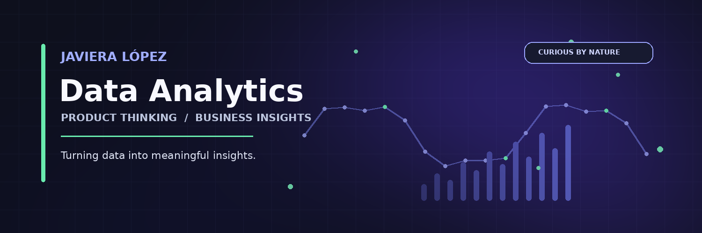

---

[README.md](https://github.com/user-attachments/files/33405844/README.md)
# Hi, I'm Javiera 👋

### Data Analytics · Product Thinking · Business Insights

I'm a UX/UI & Product Designer transitioning into Data Analytics, with a background in digital products, user experience, and business-oriented problem solving.

I'm interested in understanding what data reveals about users, products, and business performance — and translating those findings into meaningful insights that support better decisions.

## 🎯 Current Focus

- Strengthening my skills in SQL and spreadsheets
- Practicing exploratory data analysis (EDA)
- Learning to communicate findings through data visualization
- Exploring Product Analytics and Customer Experience

## 🧩 What I Bring

- **Analytical thinking:** asking the right questions and identifying patterns.
- **Product perspective:** connecting insights with user needs and product goals.
- **Business understanding:** considering how digital solutions create value.
- **User-centered mindset:** combining quantitative findings with an understanding of people.

## 🛠️ Skills & Tools

**Currently developing:** SQL · Spreadsheets · Data Analysis

**Background:** UX/UI Design · Product Design · User Research · Customer Experience

## 📂 Projects

I'm building this portfolio through practical exercises and projects that demonstrate my analytical process, from defining a problem to communicating findings and recommendations.

*Projects will be added as they are completed and documented.*

## 🌐 Connect with Me

- [Portfolio](https://javiera-portfolio.framer.website/)
- [LinkedIn](https://www.linkedin.com/in/javiera-lopez-godoy-101296193/)

---

*Curious by nature, driven by insights, and always learning.*
